# Syscall Kalman Benchmark

CT-353 Operating Systems, Complex Computing Problem (CCP).

An operating-systems project that implements 15 Linux system calls and their Windows equivalents, benchmarks them on both systems, and uses them to build a **multi-process Kalman filter**: sensor data is read through file I/O, shared through memory mapping and shared memory, filtered by worker processes, and written back to a file.

**Test machine:** Intel Core i7-7700HQ (4 cores / 8 threads), 16 GB RAM, SSD. Windows 10 native (MSYS2 MinGW-w64 GCC 14.2.0) and Ubuntu 26.04 under WSL2 (GCC 15.2.0), Release builds on both. Full record in [docs/ENVIRONMENT.md](docs/ENVIRONMENT.md).

## Key findings

| # | Finding | Numbers |
| --- | --- | --- |
| 1 | **Per-file operations are far slower on Windows; data transfer converges.** | `plat_open` 2.46 µs vs 27.34 µs, `plat_unlink` 8.56 µs vs 191 µs (11–22×). Read 3.37× → 2.11× and write 3.04× → 1.09× slower as size grows from 4 KB to 1 MB. |
| 2 | **Permission calls cost 33–57× more on Windows** because the wrappers translate mode bits to ACLs. | `plat_chmod` 3.04 µs vs 174.68 µs, `plat_chown` 3.18 µs vs 106.10 µs, `plat_stat_path` 2.03 µs vs 115.45 µs |
| 3 | **Process creation is 2.8× slower on Windows, start and wait 6.9×.** | `plat_spawn` 0.55 ms vs 1.56 ms; `plat_spawn_wait` 1.09 ms vs 7.56 ms. In the Kalman master: 0.63 ms per worker (Linux) vs 5.2 ms (Windows) |
| 4 | **First-touch memory cost reverses with the kind of mapping.** Mapping itself costs about 2 µs at every size. | Anonymous, 1 MB: 610 µs (Linux) vs 159 µs (Windows). File-backed, 1 MB: 39.65 µs vs 476.33 µs (12–13× at 16 MB) |
| 5 | **Not every wrapper is a kernel call on Windows.** | `plat_getpid` 903 ns vs 5.2 ns; `plat_umask` is emulated; both are marked n/a in the ratio chart |
| 6 | **Kalman speedup tops out at 3.45× (Linux) and 3.47× (Windows)** on 4 cores / 8 threads, and extra workers beyond 8 do not help. | Serial 2554 ms vs 2932 ms; best parallel 739 ms (7 workers) vs 837 ms |
| 7 | **The ceiling belongs to the machine, not the design** (control experiment, hypothesis H1 supported). | Independent `kf_serial` processes reach 3.2× / 3.0× at 8 processes; `kf_master` reaches 3.08× / 3.06×. Design efficiency 0.90–1.11 for 1–8 workers |
| 8 | **Parallel output is identical to serial output** on both systems, for every worker count. | Hash equal at every reported point; `est_hash` `0x07a6e04a7243bf76` (large preset) on Linux and Windows |
| 9 | **Shared memory and `mmap` keep memory flat.** | Peak per worker 1173 → 75 MiB for 1 → 16 workers; peak × workers stays near 1.2 GiB (391 MiB input + 781 MiB output) |
| 10 | **Filter accuracy.** | Position error 7.07 m (raw) → 1.48 m (filtered); predicted 1.48 m (ratio 0.998) |

Every gap has a hypothesis, a test and a status in [docs/ANALYSIS.md](docs/ANALYSIS.md); a cause is claimed only when its test has been run. Linux is measured inside WSL2 and Windows natively, so each result compares *a raw Linux system call in a VM* with *a Win32 function on native Windows*.

## Results

All charts are produced by the scripts in the repository from the CSVs in `results/` (commands in [How to reproduce](#how-to-reproduce)). Times are the median of the per-run medians over 5 repeats; the benchmark runs every case in a fresh process and records wall time, CPU time and peak memory per call (`results/linux.csv`, `results/windows.csv`: 610 rows, 0 failures).

### 1. System-call benchmarks

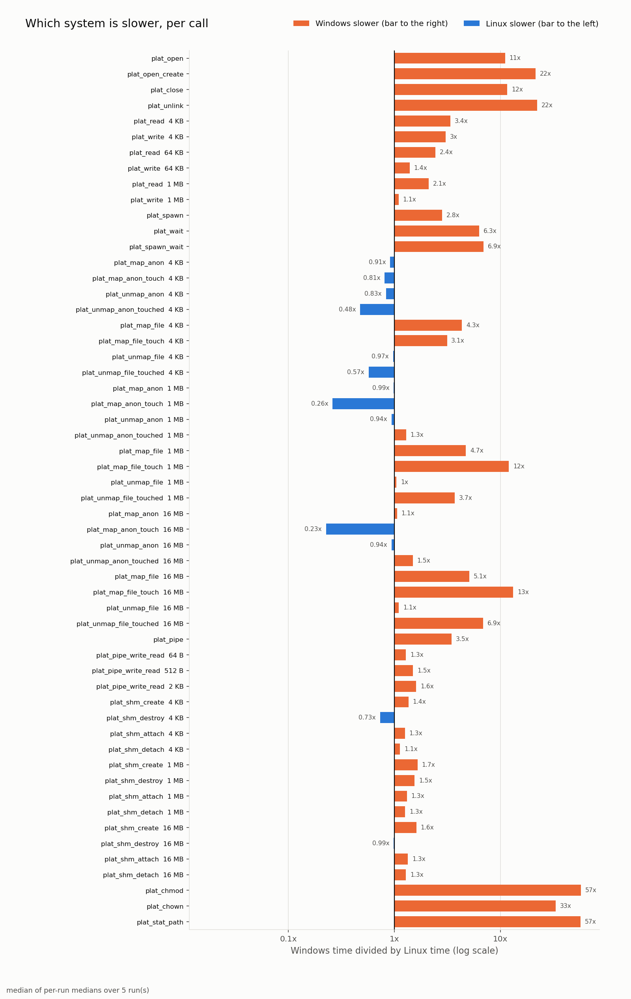

*Windows time divided by Linux time per call, on a log axis. Bars to the Windows side mean Windows is slower; `plat_getpid` and `plat_umask` are excluded because Windows does not make a system call there.*

| File I/O | Process creation and wait |
| --- | --- |
| 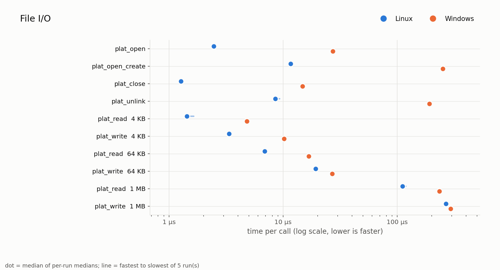 | 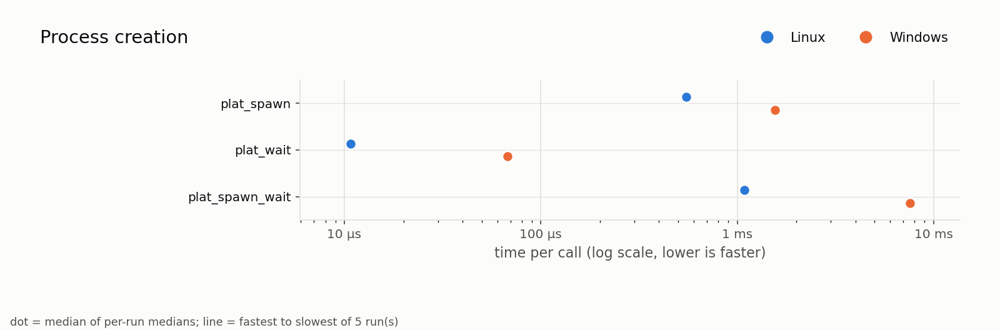 |

| Memory mapping | Pipes and shared memory |
| --- | --- |
| 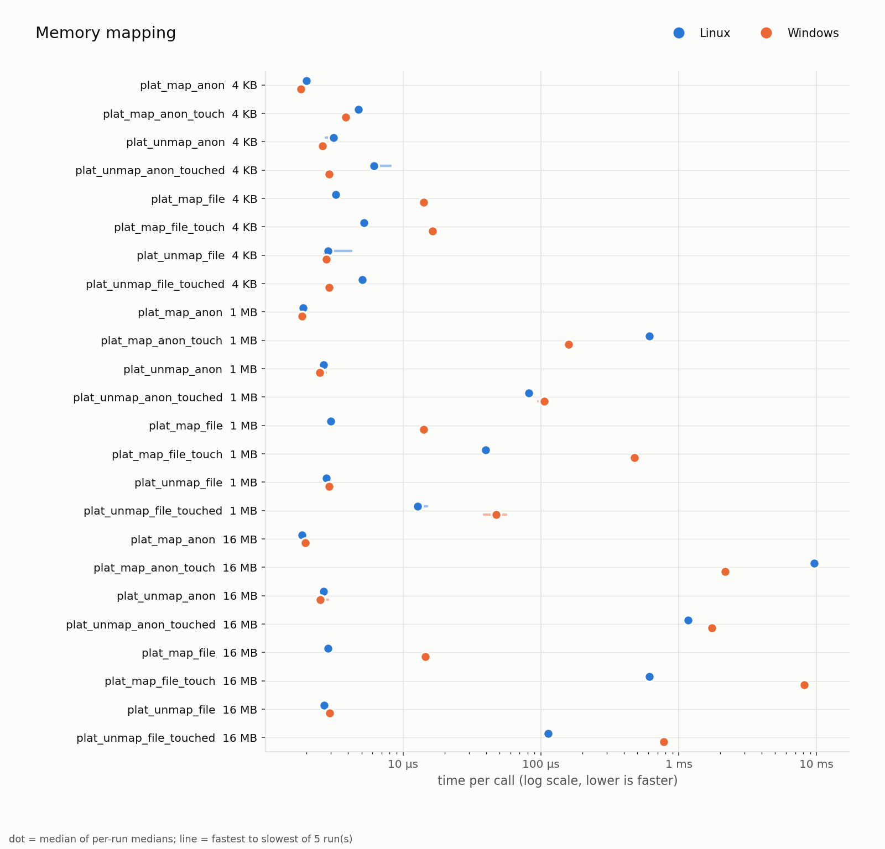 | 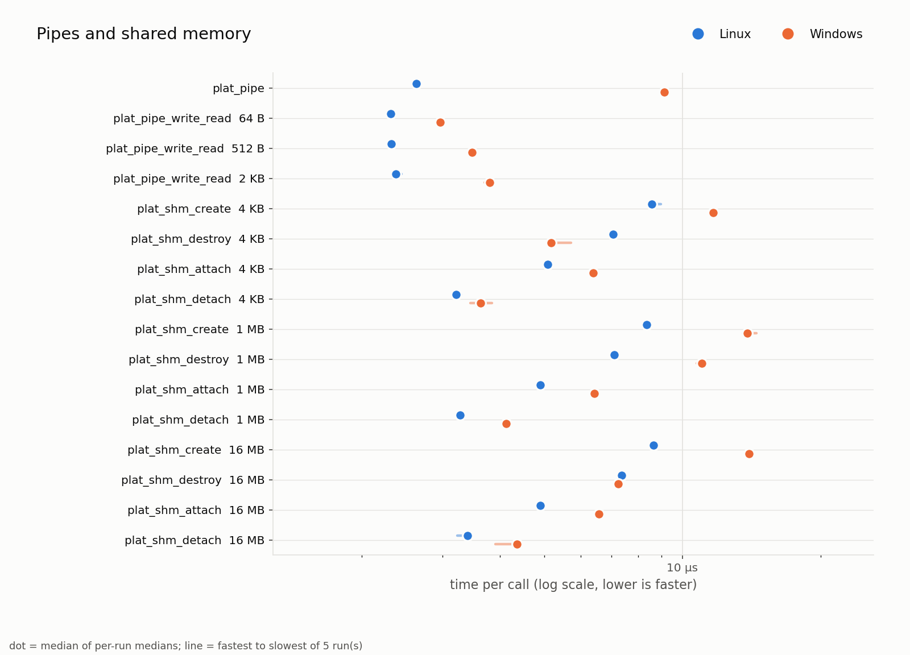 |

| Permissions | Baseline: cost of the measurement |
| --- | --- |
| 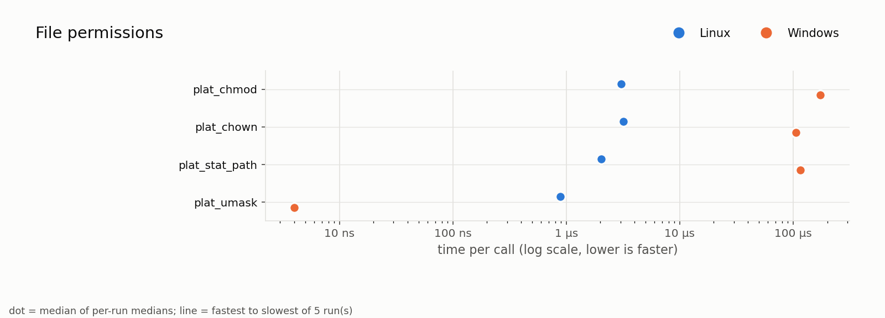 | 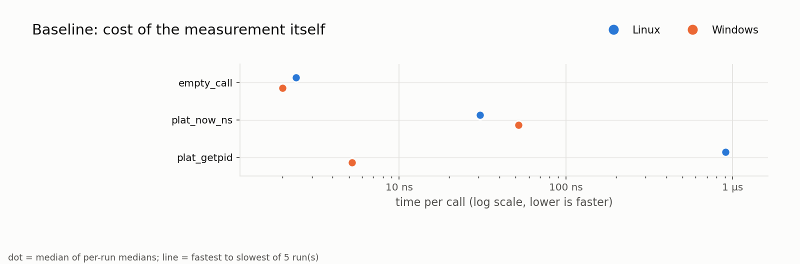 |

| File throughput by size | First-touch cost of one 4 KB page |
| --- | --- |
| 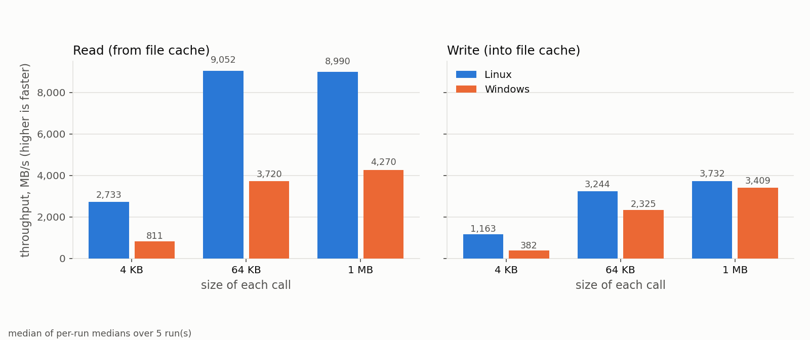 | 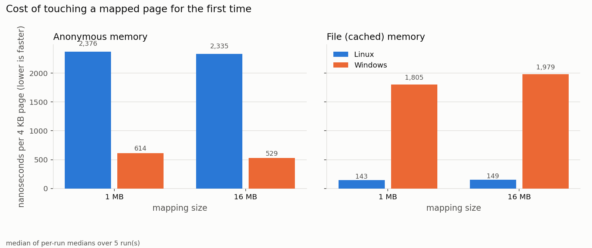 |

Full tables (median, p95, spread, CPU per call, peak memory) are in [`results/plots/summary.md`](results/plots/summary.md) and `summary.csv`. Peak memory per case is in the `peak_kb` and `peak_delta_kb` columns of the raw CSVs: an idle process peaks at about 2.1 MB on Linux and 3.5 MB on Windows, and touched mappings show about 128 MB because the benchmark runs them in batches capped near that size.

### 2. Kalman filter


*One simulated track: noisy measurements, true path and filter estimate (left), and position error over time for the raw measurement and the filter (right).*

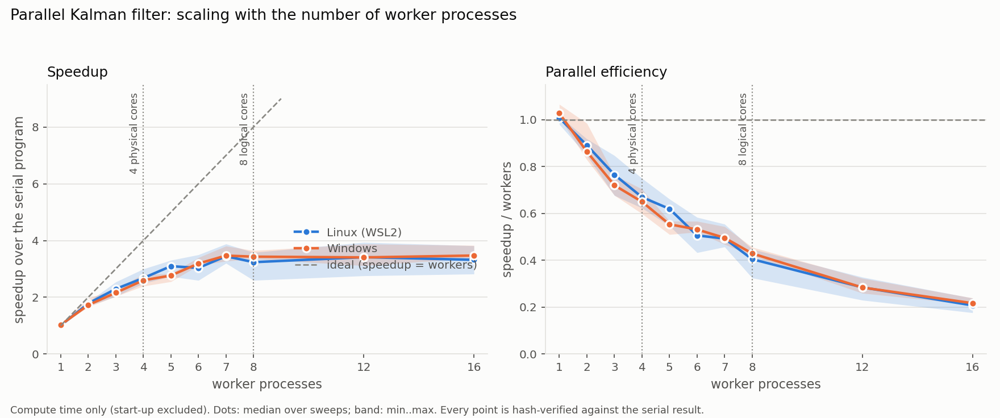

*Speedup and parallel efficiency, 1 to 16 workers, large preset (256 tracks × 100,000 steps). Vertical lines mark 4 physical cores and 8 hardware threads.*

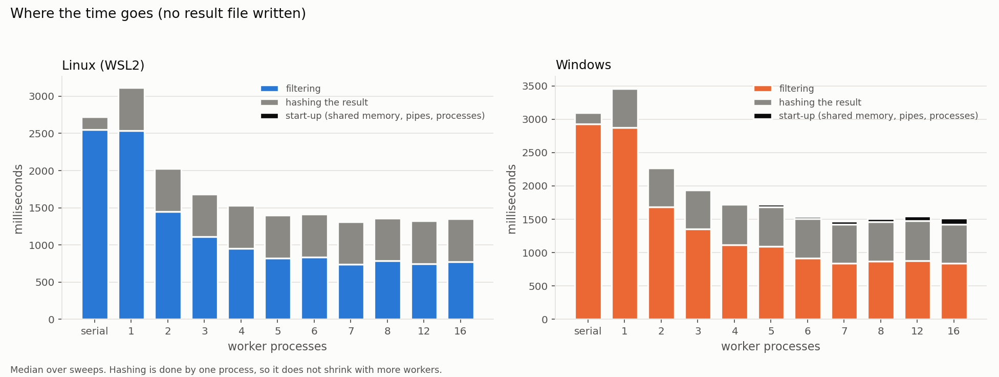

*Where the time goes for each worker count: filtering, hashing the result, and start-up of shared memory, pipes and processes.*

Numbers behind these charts: [`results/plots/scaling_summary.md`](results/plots/scaling_summary.md).

### 3. Control experiment: hardware ceiling or design?

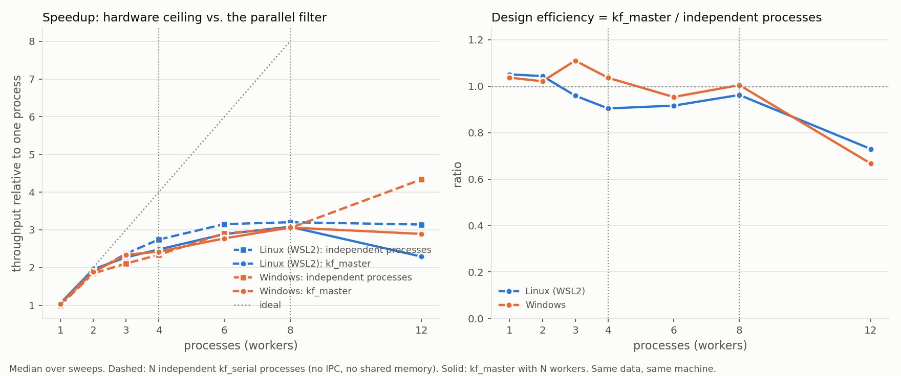

*N independent `kf_serial` processes (no shared memory, pipes or master) against `kf_master` on the same data. If independent processes stop at the same point, the design loses nothing the hardware would not take anyway.*

## Design in one minute

- **One C11 codebase, one boundary.** `include/platform.h` declares everything the portable code needs from the OS. `src/linux/` and `src/win/` implement it. Code outside those two folders never includes `<windows.h>` and never uses `#ifdef _WIN32`.
- **Every system call goes through a wrapper** that checks the result and logs the OS error (`errno` on Linux, `GetLastError()` on Windows) with `LOG_SYSERR(...)`.
- **The Kalman recursion is sequential in time**, so parallelism is across tracks: each worker process owns a block of tracks, reads input from a memory-mapped file and writes into shared memory. Workers are separate executables started with `fork`+`exec` (Linux) or `CreateProcess` (Windows).
- **Correctness gate:** every parallel run is compared by hash with the serial run.
- Details: [docs/SYSCALL_MAPPING.md](docs/SYSCALL_MAPPING.md) (Linux-to-Windows pairing), [docs/KALMAN_DESIGN.md](docs/KALMAN_DESIGN.md), [docs/BENCHMARK_METHOD.md](docs/BENCHMARK_METHOD.md), [docs/ENVIRONMENT.md](docs/ENVIRONMENT.md).

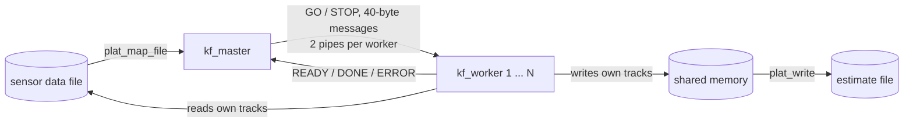

## What the project delivers

| Deliverable | Where it lives |
| --- | --- |
| 15 system calls with demo programs (Linux and Windows) | `src/linux/`, `src/win/`, `src/syscalls/` |
| Benchmark harness (time, CPU, memory per call, CSV output) | `bench/` |
| Serial and multi-process Kalman filter | `src/kalman/` |
| Linux versus Windows comparison, charts | `results/`, `bench/analyze.py`, `tools/` |
| Hypotheses, requirement evidence | `docs/ANALYSIS.md`, `docs/REQUIREMENTS.md`, `results/evidence/` |
| Report and presentation | `report/` |

## Repository layout

```
include/        platform.h (OS boundary), log.h (logging)
src/common/     portable code (logging)
src/linux/      Linux implementation of platform.h
src/win/        Windows implementation of platform.h
src/syscalls/   demo program per call group
src/kalman/     data generator, serial filter, master, workers
bench/          benchmark harness and chart script (analyze.py)
tools/          scaling and control plots, evidence collector, reference filter
data/           generated sensor files (not committed)
results/        benchmark CSVs, plots/, evidence/
report/         report notes and final report
docs/           environment record, syscall mapping, method, design, analysis
scripts/        build, data generation, benchmark and scaling scripts for both OSes
src/hello.c     Phase 1 smoke test
```

## Requirements

| Tool | Windows (cmd) | Linux (WSL2 Ubuntu) |
| --- | --- | --- |
| C compiler | GCC from MSYS2 MinGW-w64 | GCC |
| CMake | 3.20 or newer | 3.20 or newer |
| Build tool | Ninja or `mingw32-make` | Ninja or make |
| Python 3 | with matplotlib, pandas | with matplotlib, pandas |

## Setup: two clones of the same repo

The project is built natively on each OS, so each OS needs its own clone. Keep the Linux copy **inside the Linux filesystem** (`~/os-ccp`), not under `/mnt/c/...`; file access across that boundary is much slower and would distort the Linux file I/O benchmarks.

**Windows (cmd):**

```bat
cd C:\Users\Kazim\os-ccp
git clone https://github.com/arooj-zehra/syscall-kalman-benchmark .
scripts\build.bat
```

**Linux (WSL):**

```bash
cd ~/os-ccp
git clone https://github.com/arooj-zehra/syscall-kalman-benchmark .
bash scripts/build.sh
```

(`git clone ... .` works because the folders are empty.)

Both scripts configure with CMake, build in `build/`, run `ctest`, and run the smoke test. A passing run ends with `SMOKE TEST PASSED`.

To build by hand: `cmake -S . -B build -DCMAKE_BUILD_TYPE=Release`, then `cmake --build build`, then `ctest --test-dir build --output-on-failure`. Executables land in `build/bin/`.

### Windows notes

- If `build.bat` says it cannot find a build tool, install Ninja in the MSYS2 shell that matches your compiler: `pacman -S mingw-w64-ucrt-x86_64-ninja` (UCRT64) or `pacman -S mingw-w64-x86_64-ninja` (MINGW64).
- Executables are linked statically, so they run from plain `cmd` without MSYS2 on `PATH`.
- MinGW has no `fork()`. That is expected: the Windows side uses `CreateProcess` (see the mapping document).

### Day-to-day Git flow

Edit and commit on whichever OS you are working on, `git push`, then `git pull` on the other. Line endings are controlled by `.gitattributes`, so scripts stay LF for WSL and `.bat` files stay CRLF for cmd.

## How to reproduce

Run on **each** OS from the repository root. Windows equivalents use backslashes and `.bat` scripts.

| Step | Linux | Windows | Output |
| --- | --- | --- | --- |
| Benchmark, 5 repeats | `bash scripts/run_bench.sh` | `scripts\run_bench.bat` | `results/<os>.csv` |
| Charts and summary | `python3 bench/analyze.py results/linux.csv results/windows.csv` | `python bench\analyze.py results\linux.csv results\windows.csv` | `results/plots/` |
| Generate data | `bash scripts/make_data.sh large` | `scripts\make_data.bat large` | `data/` |
| Example track chart | `python3 tools/plot_track.py --meas data/meas_medium.bin --est data/est_serial_medium.bin --track 0 --steps 400` | `python tools\plot_track.py --meas data\meas_medium.bin --est data\est_serial_medium.bin --track 0 --steps 400` | `results/plots/track_example.png` |
| Parallel run | `build/bin/kf_master --in data/meas_medium.bin --workers 4 --expect-file data/est_serial_medium.bin` | same with `build\bin\kf_master.exe` | console summary |
| Scaling sweep, 1–16 workers | `bash scripts/run_scaling.sh` | `scripts\run_scaling.bat` | `results/scaling_<os>.csv` |
| Scaling charts | `python3 tools/plot_scaling.py --linux results/scaling_linux.csv --windows results/scaling_windows.csv --cores 8 --physical 4` | same | `scaling_speedup.png`, `scaling_breakdown.png`, `scaling_summary.md` |
| Control experiment | `python3 tools/run_control.py` | `python tools\run_control.py` | `results/control_<os>.csv` |
| Control chart | `python3 tools/plot_control.py --linux results/control_linux.csv --windows results/control_windows.csv --cores 8 --physical 4` | same | `control_scaling.png` |
| Requirement evidence | `python3 tools/collect_evidence.py` | `python tools\collect_evidence.py` | `results/evidence/<os>/` |

Fixed inputs make results comparable: seed 1, and the data and estimate hashes are equal on both systems.

| Preset | Size | `data_hash` | `est_hash` |
| --- | --- | --- | --- |
| small | 16 tracks × 2,000 steps | `0x317e5238757050e2` | `0x1173f7f47a860283` |
| medium | 128 × 20,000 | `0x4117eda863742630` | `0xebc944b411eaa97b` |
| large | 256 × 100,000 | `0xa8488eca6f500ab4` | `0x07a6e04a7243bf76` |

## Status of the hypotheses

| # | Observation | Status |
| --- | --- | --- |
| H1 | Speedup plateaus at about 3.4× | **Supported** by the control experiment |
| H3 | Equal speedup, unequal absolute time | **Supported** (ratio to each system's own serial run) |
| H9a | `GetCurrentProcessId` never enters the kernel | **Supported** |
| H2, H4, H6, H7, H8 | Windows serial gap, process start-up, file-open cost, first-touch costs | Hypotheses; test written, not run |
| H5, H9b | Linux run-to-run spread; high system-call entry cost on this platform | Open |

## Limitations

- Linux is measured inside WSL2 (a VM) and Windows natively; neither is bare-metal Linux.
- Windows wrappers call Win32 functions that may perform several kernel operations; Linux wrappers call the raw system call.
- Windows CPU time is counted in 15.6 ms ticks, so per-call CPU is shown only when a case used at least 150 ms of CPU in total.
- Warm page cache only.
- One machine and one CPU: the 3.4× ceiling is a property of this laptop; the method transfers, the numbers do not.

## Conventions

- **Language:** C11, warnings on (`-Wall -Wextra -Wpedantic`). The build must stay warning-free.
- **Logging:** use `LOG_INFO/WARN/ERROR`; after a failing system call use `LOG_SYSERR("call(args)")` before anything else can overwrite the error code.
- **Timing:** `plat_now_ns()` is the only clock the benchmarks use.
- **Benchmark builds** are `Release` on both systems with the same optimisation level.
- **Reproducibility:** fixed random seeds, machine details recorded in `docs/ENVIRONMENT.md`, results stored as CSV under `results/`.


